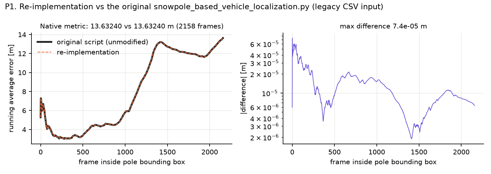
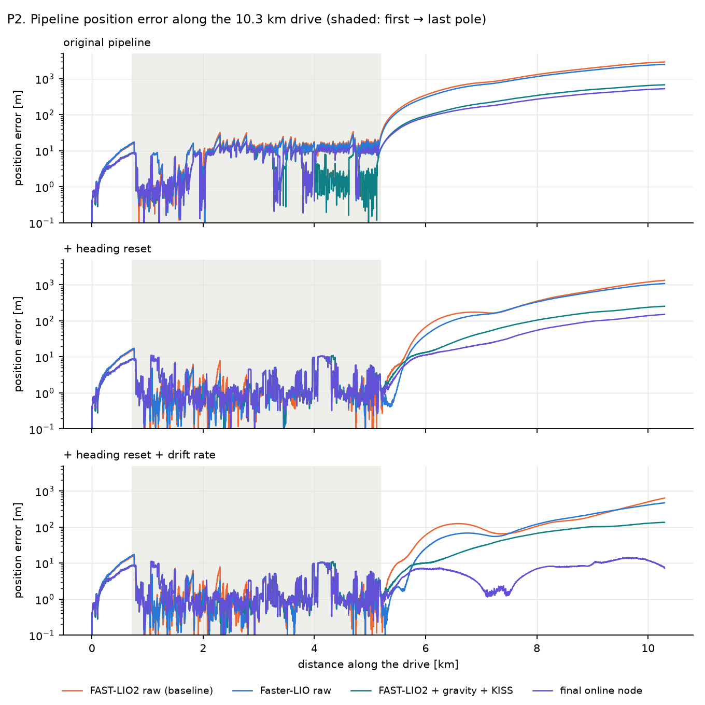
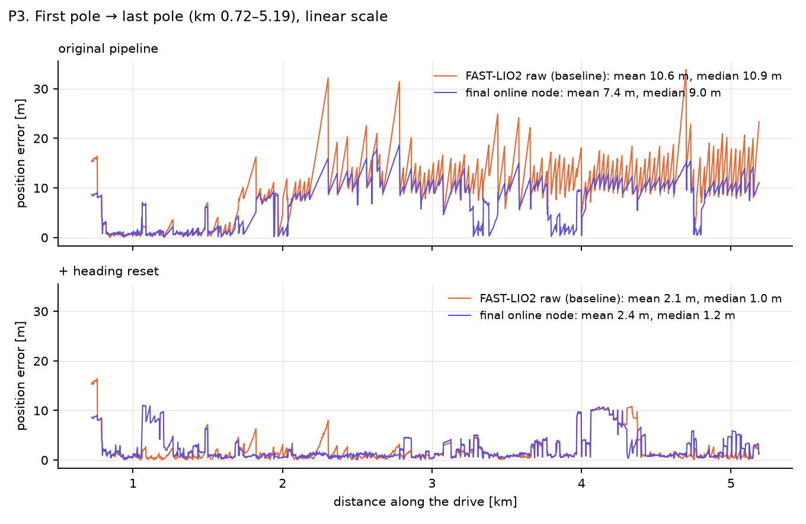
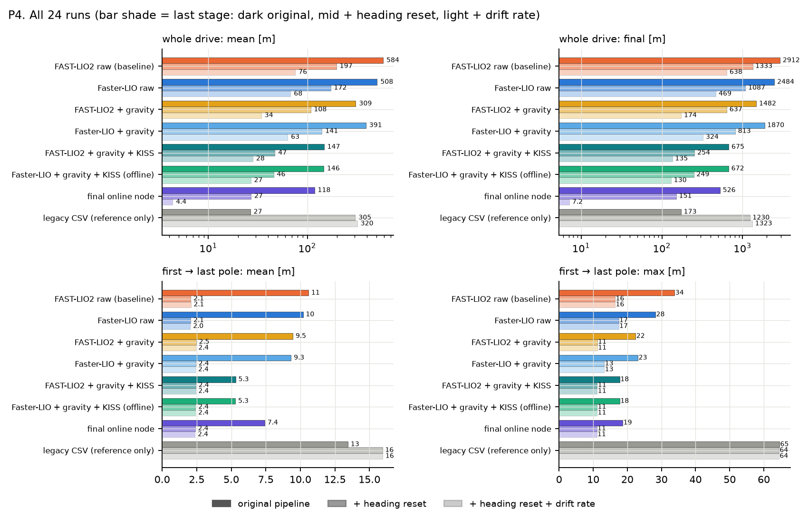
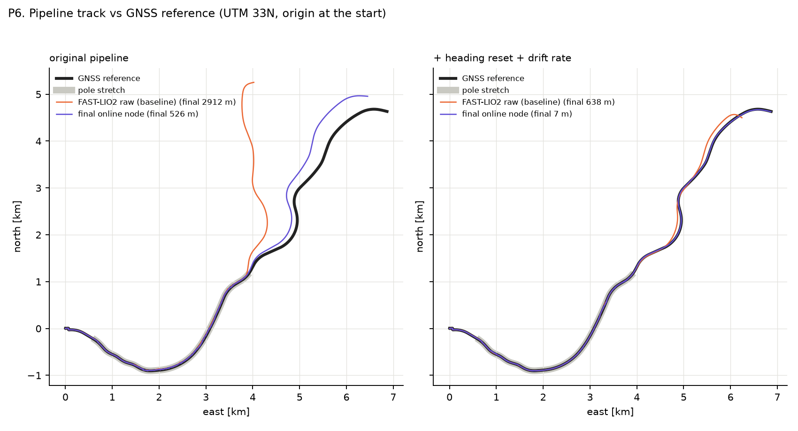
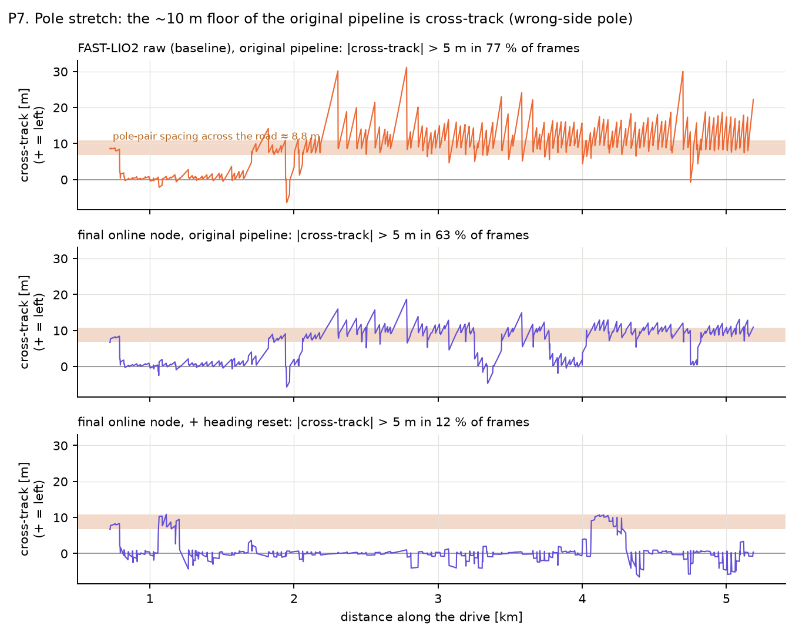
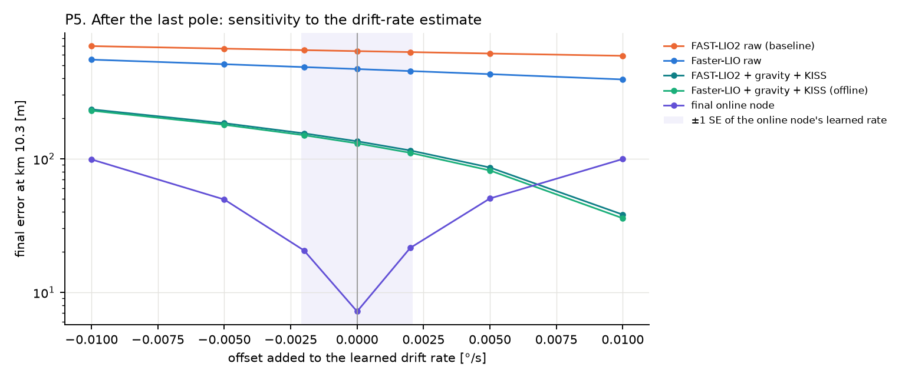

# lio_bench — Report v3: heading, online attitude, and what a paper can claim

*Autonomous overnight run, 2026-10-11 (01:50 →). Odometry only. Builds on REPORT_v2 (Phase A audit)
and METHODS.md. Raw numbers: `results/v3/*.json`, `results/v3_*.json`. Nothing committed to git.*

> All sections complete (2026-10-11 ~10:30); §12 (stage 3, the snow-pole pipeline) added in the afternoon. ✅ done · ❌ rejected hypothesis.

---

## 0. Executive summary

0. **Final system (§11):** real-time node = Faster-LIO + gravity correction + KISS-ICP heading
   (2.0 m voxels): **6.1 m per held-out km vs 51.2 m for raw FAST-LIO**; keeps real time on the laptop
   (corrected pose 47 ms after the scan, 71 % CPU, 148 MB); exported for the snow-pole pipeline.
00. **Snow-pole pipeline (§12):**
   - The re-implementation matches the original script frame by frame (13.6324 m, 358 fixes).
   - **Pole span:** baseline 10.6 m mean → 2.4 m mean / 1.2 m median (final node + heading reset).
   - **Whole 10.3 km:** final error 2 912 m (baseline) → 526 m (final node, original pipeline)
     → 151 m (+ heading reset). With drift-rate extrapolation it reaches 7 m, but that is
     fragile (~7–50 m).
   - The ~10 m floor of the original pipeline is wrong-side pole association, triggered by
     heading drift.
1. **A deployable pipeline more than halves the error, with no ground truth, no CAN and no
   learning.** Faster-LIO translation + online gravity-filtered attitude + heading from a
   LiDAR-only odometry (KISS-ICP). Over 5 held-out ~2 km blocks: mean ATE 72.3 m (raw) →
   46.0 m (online gravity filter) → **17.9 m**, better in **5/5** blocks (paired Δ −28.0 ± 9.4 m).
   Adding always-on gravity-locked VGICP gives 16.4 m and the best local drift (0.91 % per 200 m).
2. **The online gravity filter equals the offline planar fix** (Δ −1.1 ± 1.5 m), and its time
   constant is not sensitive: flat from 0.5 to 10 s, chosen on validation (5 s).
3. **Heading is the dominant error, and its source is method-dependent.** Every IMU-coupled
   estimator has a yaw-rate bias of 0.044–0.059°/s that varies 3–20× between blocks. LiDAR-only
   KISS-ICP has 0.024°/s, 3–5× more stable. That is why "yaw from the least-biased source"
   (KISS-ICP, chosen on the training blocks in 5/5 folds) is the strongest single lever.
4. **Selective correction does not pay on this data.** VGICP applied to every 5th/10th/20th scan
   gives nothing; every 2nd scan gives −3 m; always-on gives −10 m (3/5 blocks).
   Information-weighted (filter-style) fusion is no better than direct correction
   (−11.5 vs −9.6 m, within SE). The review's selective-correction idea addresses an effect that
   is small here; the heading source is the big lever.
5. **CAN wheel speed is not needed** once tilt and heading are handled (no gain).
6. **Calibrating a constant yaw bias helps but is fragile.** It gets 14–16 m with heading
   error 0.7°, but the LIO biases are not constant across blocks: it helps Faster-LIO in 4/5
   blocks and FAST-LIO in 2/5. Not a deployable claim from one drive.
7. **Significance and reproducibility.** With 10 one-km blocks the heading-source effect wins
   9/10 for both LIO baselines (exact sign test p = 0.021). Repeat runs vary ±1.5–4 % in ATE,
   far below every between-method difference.
8. **Mechanisms found:**
   - **pitch:** the pitch-up drift exists in LiDAR-only KISS-ICP too and is carried by
     ground returns beyond ~10 m (ground removed: climb 2.2 km → 0.1 km);
   - **heading:** uncompensated motion distortion produces a strong counter-clockwise heading
     bias in both KISS-ICP and GenZ-LIO, roughly linear in the amount of distortion.
9. **Hypotheses tested and rejected (each with a direct test):** Earth-rate removal (helps the
   gyro-free control equally); scene-driven leakage (correlations don't survive multiple
   testing); IMU-noise tuning (×10 / ×100: no change); short gyro-bias initialisation (the
   initial bias is correct); online gyro-bias wander as the carrier (correlated r = 0.87, but
   freezing it changes nothing). **Why the LIOs' heading is 2× more biased than KISS-ICP's
   remains open.**
10. **Learned fusion's real role is translation:** it lowers local drift 7–11 % in 5/5 held-out
    blocks when heading comes from KISS-ICP. It cannot fix heading, because per-step GT yaw is
    noise-dominated.

---

## 1. What was implemented overnight

| component | file | what |
|---|---|---|
| fast offline gravity filter | `correct/heading.py::gravity_filter` | exact replica of the scan-pass `grav_only` (whole-drive ATE 966 vs 965 m) for tuning |
| heading tools | `correct/heading.py` | Earth-rate removal, training-block yaw-bias calibration, no-side-slip, yaw resampling for hybrids |
| leave-one-block-out evaluation | `v3.py::run`, `run_combos`, `paired` | 5 blocks; calibration/selection on the other 4; canonical scoring; paired Δ ± SE and sign counts |
| combined pipelines | `v3.py::combo` | translation from A, heading from B, optional calibration / CAN |
| selective + information-weighted VGICP | `correct/scanpass.py` | `vgicp_grav_every{2,5,10,20}` (map updated every scan), `vgicp_grav_da` |
| yaw-leakage test variants | `correct/scanpass.py` | `vgicp_grav_cvrot` (prediction rotation from its own constant-velocity model), `vgicp_grav_cv` (no LIO in the prediction) ✅ (needed a rigidity fix, §6) |
| LiDAR-side yaw-bias probes | `correct/kiss_probe.py`, `liobench kiss-probe` | KISS-ICP with deskew off / reversed timing / timing shift / 0.5 m voxels / ground removed / near points removed / upper beams ✅ |
| GenZ-LIO full IMU-bias logging | `genz_runner.py` | `bg_x/y/z`, `ba_x/y/z` per scan ✅ (§8) |
| GenZ-LIO deskew probe | `genz_runner.run(time_scale=)`, `--time-scale` | per-point times ×0, ×0.5 ✅ (§7b) |
| LIO IMU-noise probe | `configs/algorithms/variants/faster_lio_{bgyr100,imunoise10}.yaml` | ✅ (§5b) |
| GenZ-LIO init-window override | `GENZ_INIT_IMU_SAMPLES` (C++ patch in `setup/install_genz_py.sh`, default unchanged) | ✅ used to reject a hypothesis (§8) |
| frozen gyro-bias probe | `variants/faster_lio_bgyrfrozen.yaml`, `variants/genz_lio_bgyrfrozen.yaml` | ✅ (§8b): **negative** |
| run-to-run repeats | `scripts/run_v3_queue.sh` | FAST-LIO ×2, DLIO ×2 more full ROS runs ✅ (§5) |

All heavy jobs run strictly one at a time under a 3–4 GB RAM cap (`scripts/run_v3_queue*.sh`).

---

## 2. Online gravity filter: time-constant sweep ✅

Faster-LIO / FAST-LIO; selection on the **validation** block (drift per 200 m); test reported
once. With motion compensation (vehicle acceleration from IMU + baseline speed):

| τ (s) | 0.5 | 1 | 2 | **5** | 10 | 20 | 50 | 100 |
|---|---|---|---|---|---|---|---|---|
| val drift % (Faster-LIO) | .843 | .843 | .843 | **.842** | .844 | .850 | .897 | 1.126 |
| test drift % (Faster-LIO) | .934 | .922 | .917 | **.919** | .928 | .953 | 1.148 | 1.910 |
| val drift % (FAST-LIO) | .843 | .846 | .848 | .851 | .856 | .870 | 1.003 | 1.737 |
| test drift % (FAST-LIO) | .660 | .647 | .645 | .652 | .669 | .722 | 1.150 | 2.770 |

**Flat for 0.5–10 s; degrades above 20 s** (pitch drift outruns the correction). Motion
compensation changes val drift by ~0.01 points. The method is robust to its only parameter;
**τ = 5 s** (val-selected for the primary backbone).

---

## 3. Heading: diagnosis ✅

### 3.1 Yaw-rate bias per block, °/s (slope of source heading − GT course)

| source | b0 | b1 | b2 | b3 | b4 | mean | std |
|---|---:|---:|---:|---:|---:|---:|---:|
| Faster-LIO | .027 | .056 | .066 | .101 | .046 | .059 | .028 |
| FAST-LIO | .017 | .065 | .025 | .101 | .025 | .047 | .036 |
| DLIO | .024 | .040 | .005 | .114 | .037 | .044 | .042 |
| GenZ-LIO | .034 | .060 | .015 | .082 | .030 | .044 | .027 |
| VGICP-grav (LIO-seeded) | .038 | .018 | .037 | .056 | .070 | .044 | .020 |
| **KISS-ICP** | .015 | .021 | .022 | .035 | .028 | **.024** | **.008** |

All sources drift counter-clockwise. The IMU-coupled estimators share a spike in block 3
(km ≈ 6–8) that KISS-ICP barely shows.

### 3.2 Hypotheses tested

| hypothesis | test | result |
|---|---|---|
| Earth rotation (0.0037°/s at 63.2° N, unmodelled by all LIOs) | remove it; KISS-ICP (no gyro in yaw) as a control | ❌ **not supported:** KISS-ICP improves as much as the LIOs (whole-drive ATE 366 → 299 m); the gain is indistinguishable from generic CCW-bias removal |
| constant gyro bias | per-block stability | ❌ LIO biases vary 3–20× between blocks; not a constant |
| scene-dependent leakage (weak LiDAR rotation constraint → gyro-driven prediction wins) | Spearman of LIO excess bias over KISS-ICP vs scene features, 17 × 30 s windows | ⚠️ **weak:** Faster-LIO excess correlates with planar fraction (ρ +0.63, p = .007), speed (+0.60), weak translational constraint (−0.53); nothing significant for FAST-LIO / DLIO / GenZ-LIO; does not survive multiple-testing correction; rotational information shows no correlation |
| prediction leakage into scan-to-map ICP | gravity-locked VGICP with its own constant-velocity rotation vs the LIO's rotation | ⚠️ partial: whole-drive ATE 711 → 285 m, but per-block mean bias unchanged (§6) |
| LiDAR-side per-scan bias (deskew / timing) | KISS-ICP probes | ✅ **motion distortion is a strong CCW bias source** (deskew off ×4.5, reversed ×7.4); KISS-ICP's own 0.024°/s floor is not leftover distortion (§7) |
| distortion → heading bias also in an LIO? | GenZ-LIO with per-point times ×0 and ×0.5 | ✅ **yes**: 0.045 → 0.100 → 0.148°/s (§7b) |
| short gyro-bias initialisation (0.1–0.2 s) | true standstill bias vs the LIO's initial estimate | ❌ **rejected**: the initial estimate is correct (−0.00065 rad/s); my earlier "+0.003 rad/s while parked" included the start of motion (§8) |
| online gyro-bias estimate wanders and *carries* the heading drift | GenZ-LIO's logged z-bias vs true standstill bias, per block; then the bias held near-frozen | ❌ **rejected as a cause**: correlated (r = +0.87), but halving the bias wander leaves the heading bias unchanged (0.0449 → 0.0452°/s). Both are symptoms of the same rotation error (§8b) |
| IMU-noise tuning artefact | Faster-LIO with gyro-bias walk ×100 / IMU noise ×10 | ❌ **rejected**: bias and climb unchanged (§5b) |

---

## 4. Leave-one-block-out results ✅

Protocol: 5 contiguous time blocks (~108 s, ~2 km each). For each held-out block, anything
calibrated or selected uses the other four blocks only. The held-out block is scored
canonically: 200 m start fit, then prediction. Paired Δ vs the online gravity filter (G),
± SE over the 5 blocks, and the number of blocks where the pipeline is better.

### 4.1 Heading pipelines

| Faster-LIO baseline | ATE | Δ vs G ± SE | better | final | drift / 200 m | \|heading\| at block end |
|---|---:|---:|---:|---:|---:|---:|
| raw | 72.3 | +26.1 ± 15.5 | 1/5 | 164.9 | 4.06 % | 6.9° |
| planar (offline) | 45.1 | −1.1 ± 1.5 | 2/5 | 102.5 | 1.06 % | 5.7° |
| **G: gravity filter (online)** | 46.2 | — | — | 103.9 | 1.08 % | 5.7° |
| G + own yaw bias (calibrated) | 21.4 | −24.8 ± 9.1 | 4/5 | 43.6 | 0.98 % | 2.1° |
| **G + yaw from least-biased source** (KISS-ICP in 5/5 folds) | **17.9** | **−28.3 ± 9.8** | **5/5** | 35.2 | 0.99 % | 2.3° |
| G + least-biased source, calibrated | 15.5 | −30.7 ± 13.6 | 5/5 | 25.8 | 0.98 % | 0.7° |

FAST-LIO baseline: G 36.0 m → least-biased-source heading 17.5 m (−18.5 ± 8.1, 5/5); own-bias
calibration 28.5 m (2/5 only).

### 4.2 Correction schedule, direct vs filter-style, CAN

| Faster-LIO baseline | added cost / scan | ATE | Δ vs G ± SE | better | drift / 200 m | better |
|---|---:|---:|---:|---:|---:|---:|
| G | ~0 | 46.0 | — | — | 1.066 % | — |
| VGICP-grav every 20 scans | 3.0 ms | 46.6 | +0.6 ± 2.3 | 4/5 | 1.161 % | 2/5 |
| every 10 | 3.6 ms | 46.7 | +0.7 ± 3.5 | 2/5 | 1.110 % | 3/5 |
| every 5 | 4.6 ms | 46.9 | +0.9 ± 5.1 | 2/5 | 1.075 % | 3/5 |
| every 2 | 7.6 ms | 42.7 | −3.2 ± 7.8 | 3/5 | 1.027 % | 4/5 |
| every scan, direct | ~15 ms | 36.3 | −9.6 ± 9.2 | 3/5 | 0.985 % | 4/5 |
| every scan, information-weighted | 12.4 ms | 34.5 | −11.5 ± 9.7 | 3/5 | 0.981 % | 4/5 |
| **G + KISS-ICP yaw** | KISS ≈ 34 ms (Python) | **17.9** | **−28.0 ± 9.4** | **5/5** | 0.989 % | 3/5 |
| VGICP every 20 + KISS yaw | | 18.0 | −28.0 ± 9.8 | 5/5 | 1.047 % | 2/5 |
| VGICP every 5 + KISS yaw | | 16.8 | −29.2 ± 9.8 | 5/5 | 0.958 % | 4/5 |
| **VGICP every scan + KISS yaw** | | **16.4** | −29.6 ± 9.9 | 5/5 | **0.914 %** | 4/5 |
| G + KISS yaw + CAN distance | | 18.2 | −27.8 ± 10.5 | 4/5 | 1.073 % | 4/5 |
| VGICP + KISS yaw + CAN | | 17.9 | −28.1 ± 10.8 | 4/5 | 1.162 % | 4/5 |
| G + KISS yaw, calibrated | | 15.5 | −30.5 ± 13.1 | 5/5 | 0.975 % | 2/5 |
| VGICP + KISS yaw, calibrated | | 14.4 | −31.6 ± 13.6 | 5/5 | 0.905 % | 4/5 |

The "selected costs" are offline Python timings on the laptop (§9).

---

### 4.3 Significance with 10 blocks (~1 km each)

| pipeline | ATE | Δ vs G ± SE | better | exact sign test |
|---|---:|---:|---:|---:|
| Faster-LIO + gravity filter (G) | 12.7 | — | — | — |
| G + KISS-ICP yaw | 7.7 | −5.0 ± 2.3 | 9/10 | p = 0.021 |
| VGICP-grav + KISS-ICP yaw | 7.1 | −5.6 ± 2.4 | 9/10 | p = 0.021 |
| FAST-LIO G | 9.6 | −3.1 ± 1.7 | 7/10 | p = 0.34 |
| FAST-LIO G + KISS-ICP yaw | 7.4 | −5.3 ± 2.2 | 9/10 | p = 0.021 |
| KISS-ICP alone + gravity filter | 7.9 | −4.7 ± 2.4 | 8/10 | p = 0.11 |

The heading-source effect is significant at the 5 % level for both LIO baselines. **KISS-ICP alone
(gravity-filtered) is nearly as good on position** as the hybrids. The hybrids' remaining
advantage is local drift (VGICP + KISS yaw: 0.57 % vs KISS-ICP alone 0.80 % per 200 m).

### 4.4 Learned fusion vs the physics rule ✅

Same tilt-invariant step table, same 5 held-out blocks, canonical scoring. Learned models are
retrained per fold on the other 4 blocks. Inputs: baseline, KISS-ICP, DLIO, GenZ-LIO + context.
Paired Δ vs the rule "translation from the baseline, yaw from KISS-ICP" (negative = better than the rule).

| Faster-LIO / FAST-LIO baseline | ATE | Δ vs rule ± SE | better | drift / 200 m | better |
|---|---:|---:|---:|---:|---:|
| **rule** | 16.4 / 16.2 | — | — | 1.03 / 1.01 % | — |
| baseline alone (tilt-invariant) | 60.2 / 50.5 | +44 / +34 | 0/5 | 2.5 / 2.4 % | 2/5 |
| static inverse-variance | 31.7 / 29.2 | +15 / +13 | 0/5 | 0.99 / 0.95 % | 3/5 |
| linear gating | 23.0 / 22.4 | +6.5 / +6.2 | 1–2/5 | 0.88 / 0.89 % | 4/5 |
| MLP-16 | 34.2 / 31.6 | +18 / +16 | 0/5 | 0.94 / 0.93 % | 3/5 |
| **linear gating translation + KISS yaw** | **15.8 / 15.8** | −0.7 ± 0.7 / −0.3 ± 0.6 | 4/5, 3/5 | **0.92 / 0.93 %** | **5/5** |
| MLP-16 translation + KISS yaw | 16.0 / 16.2 | −0.5 / 0.0 | 3/5 | 0.90 / 0.91 % | 5/5 |

**Reading:** learned gating cannot fix heading. It is trained per step, and per-step GT yaw is
dominated by GNSS noise (REPORT_v2 §2), so a slow bias is invisible to its loss. Its legitimate
contribution is **translation mixing**: with heading from KISS-ICP it lowers local drift by
7–11 % in **5/5** held-out blocks at equal ATE. Division of labour: **physics picks the heading
source; learning mixes translation.**

## 5. Run-to-run variation ✅

Three full ROS runs each, deployable protocol, whole drive:

| | yaw bias (mean over blocks) | raw ATE | gravity-filtered ATE | heading at km 10 (G) | climb |
|---|---:|---:|---:|---:|---:|
| FAST-LIO runs 1 / 2 / 3 | .0465 / .0459 / .0482°/s | 1 486 / 1 483 / 1 499 m | 818 / 812 / 836 m | +22.2 / +21.6 / +22.8° | 3 436 / 3 428 / 3 359 m |
| DLIO runs 1 / 2 / 3 | .0438 / .0401 / .0448°/s | 1 103 / 1 086 / 1 166 m | 596 / 597 / 646 m | +20.2 / +19.2 / +21.0° | 3 229 / 3 240 / 3 318 m |

Run-to-run spread: ±1.5 % (FAST-LIO) and ±4 % (DLIO) in ATE, ±0.002°/s in bias. **Every
between-method difference in this report is several times larger.** Faster-LIO (this build)
and GenZ-LIO are deterministic.

### 5b. IMU-noise tuning (Faster-LIO) ✅

| config | yaw bias | raw ATE | G ATE | heading (G) | climb |
|---|---:|---:|---:|---:|---:|
| default (`b_gyr_cov` 1e-4, `acc/gyr_cov` 0.1) | .0590°/s | 1 245 | 966 | +29.4° | 2 408 m |
| gyro-bias random walk ×100 | .0585°/s | 1 238 | 953 | +28.8° | 2 385 m |
| IMU measurement noise ×10 | .0559°/s | 1 174 | 888 | +28.8° | 2 511 m |

**The pitch and heading drift are not an IMU-noise tuning artefact.** Neither "re-estimate the
bias faster" nor "trust LiDAR more" changes them.

## 6. Yaw-leakage test (constant-velocity prediction) ✅

Gravity-locked VGICP with the prediction's rotation (and translation) taken from its own
previous step instead of the LIO. The first attempt diverged: rotation built from the previous
step amplified rounding error ~2.4× per scan. Fixed by re-projecting onto SO(3) every scan.

| VGICP-grav, prediction from | yaw bias mean (std) | whole ATE | heading at km 10 | climb |
|---|---:|---:|---:|---:|
| LIO rotation + translation | .044 (.020)°/s | 711 m | +25.5° | +619 m |
| **own rotation, LIO translation** | .042 (.062)°/s | **285 m** | **+16.4°** | +533 m |
| nothing from the LIO | .131 (.772)°/s | 1 897 m | +50.6° | +542 m |
| (KISS-ICP, reference) | .024 (.008)°/s | 563 / 380 m (G) | +11.5° | +2 155 m |

**Reading:**
- Keeping the LIO's gyro-driven rotation *out* of the prediction cuts whole-drive error 2.5×,
  but the per-block mean bias is unchanged and block-to-block variability triples. It is
  partial support for leakage, not proof.
- Without the LIO's translation, VGICP fails outright: on this road scan registration alone
  cannot hold forward motion.
- Gravity locking also limits the climb (+533–619 m vs +2 155 m for KISS-ICP).

## 7. LiDAR-side bias probes (KISS-ICP) ✅

KISS-ICP (LiDAR only) re-run over the whole drive with one change to its input each time.
Yaw-rate bias per block (°/s) and whole-drive heading error (deployable protocol):

| probe | b0 | b1 | b2 | b3 | b4 | **mean** | heading at km 10 | whole ATE (raw / gravity-filtered) |
|---|---:|---:|---:|---:|---:|---:|---:|---:|
| default (deskew with per-point times) | .015 | .021 | .022 | .035 | .028 | **.024** | +9.9° | 563 / 380 m |
| **deskew off** | .121 | .142 | .066 | .111 | .102 | **.109** | **+58.7°** | 2 270 / 2 144 m |
| **deskew reversed** (2× distortion) | .207 | .235 | .126 | .170 | .158 | **.179** | **+99.5°** | 3 514 / 3 404 m |
| 0.5 m map voxels | .017 | .027 | .018 | .048 | .044 | .031 | +12.6° | 755 / 462 m |
| point times +5 % of the scan | .009 | .013 | .021 | .035 | .036 | .023 | +8.3° | 473 / 291 m |

**Findings:**
1. **Uncompensated motion distortion produces a strong, direction-consistent
   (counter-clockwise) heading bias** that grows roughly linearly with the amount of
   distortion: about 0.07–0.08°/s per scan's worth (off → reversed). The car moves ~2 m during
   one 0.1 s scan. The two sides of the road are captured at different moments, the scan is
   sheared, and registration absorbs the shear as a small rotation of fixed sign. The sign is
   set by the spin direction relative to forward motion, which plausibly explains why **every**
   method here drifts counter-clockwise.
2. **The point timing is used correctly.** Reversing it makes the bias 7× worse.
3. **Small timing errors don't matter** (+5 % shift: unchanged). **Map resolution matters
   little** (0.5 m voxels: +0.007°/s).
4. **KISS-ICP's own residual (0.024°/s) is *not* explained by leftover distortion.**
   Extrapolating the off/reversed trend to zero distortion gives ~0.03°/s. There is a floor of
   ~0.02–0.03°/s from something else (registration on an asymmetric scene, or the sensor), not
   identified here.

### 7b. The same distortion probe on an LIO (GenZ-LIO) ✅

| GenZ-LIO (offline), per-point times | yaw bias mean (std) | whole ATE raw / G | heading (G) | climb |
|---|---:|---:|---:|---:|
| ×1 (as recorded) | .045 (.026)°/s | 1 414 / 835 m | +22.3° | +3 337 m |
| ×0.5 (half compensation) | .100 (.041)°/s | 2 558 / 2 099 m | +51.5° | +2 426 m |
| ×0 (no compensation) | .148 (.062)°/s | 3 501 / 3 093 m | +76.0° | +1 796 m |

**The distortion → heading-bias link generalises to an IMU-coupled estimator:** same direction,
similar sensitivity (~0.10°/s per scan's worth vs ~0.085 for KISS-ICP), and the same
opposite-sign effect on climb.

### 7c. Pitch: the LiDAR-only estimator climbs too ✅

Height gained by km 10.3 (GNSS: −163 m) under the same probes:

| KISS-ICP probe | climb | mean climb angle | body pitch at end |
|---|---:|---:|---:|
| default deskew | +2 155 m | +11.8° | +28.0° |
| times +5 % | +2 149 m | +11.8° | +27.5° |
| 0.5 m voxels | +2 617 m | +14.3° | +35.2° |
| deskew off | +1 279 m | +7.1° | +27.8° |
| deskew reversed | +410 m | +2.3° | +23.9° |
| (Faster-LIO, for comparison) | +2 408 m | +13.2° | +34.8° |

1. **The pitch-up drift exists without any IMU.** It is a property of LiDAR registration on
   this road, so v2's explanation (gravity leaking into forward acceleration) cannot be its
   *origin*. That ambiguity only explains why the IMU-coupled estimators fail to *suppress* it.
2. **Motion distortion moves pitch linearly but in the opposite direction to heading:** less
   compensation means less climb (−870 m per scan's worth of distortion). So leftover
   distortion does not cause the climb.
3. **Leading hypothesis: ground geometry or beam-elevation calibration.** The ground is 73 % of
   all points and lies entirely in rings 64–127. Small per-beam elevation errors would make flat
   ground look like a shallow cone, and registering successive cones while driving tilts the
   solution steadily.

**Geometry probes** (KISS-ICP, whole drive):

| points used | climb | yaw bias | heading (G) |
|---|---:|---:|---:|
| all (default) | +2 155 m | .024°/s | +11.5° |
| **ground removed** (z > −1 m in the sensor frame) | **+101 m** | .045°/s | +31.6° |
| points < 10 m removed | +2 124 m | .024°/s | +11.6° |
| upper beams only (rings 0–63) | diverged: no ground, degenerate; discarded | | |

4. **The pitch-up bias is carried by the ground returns beyond ~10 m.** Removing the ground
   collapses the climb from 2.2 km to 0.1 km. Removing only near points changes nothing. This
   fits a small beam-elevation calibration error or the real road/snowbank shape (camber,
   banks), which this data can't separate.
5. **The ground also helps heading** (removing it doubles the yaw bias). Ground removal is not
   a fix; it trades pitch for heading.

## 8. GenZ-LIO gyro-bias trajectory ✅

**A hypothesis rejected first.** The LIOs initialise the gyro bias from 0.1–0.2 s of IMU data
(FAST-LIO 10 samples, Faster-LIO / GenZ-LIO 20). Re-running GenZ-LIO with a 6 s window (via the
new `GENZ_INIT_IMU_SAMPLES`) gave the same z-bias. Gyro z by standstill slice:

| slice | 0–1 s | 0–2 s | 2–4 s | 4–6 s | **6–8 s** | 8–9 s |
|---|---:|---:|---:|---:|---:|---:|
| gyro z mean (rad/s) | −.00059 | −.00075 | −.00058 | −.00063 | **+.0108** | +.0354 |

The car starts turning at ~6 s while CAN still reads zero speed. The true bias is
**−0.00065 rad/s** and the 0.2 s initialisation already gets it. (v2's "+0.003 rad/s while
parked" was contaminated; erratum added to REPORT_v2.)

**What does carry the drift: the online bias estimate.** GenZ-LIO's z-bias estimate wanders
from −0.0006 to −0.0025 rad/s during the drive. The yaw-rate error this causes, relative to the
true bias, against the measured heading bias:

| block (s) | 0–108 | 108–217 | 217–325 | **325–433** | 433–542 | mean |
|---|---:|---:|---:|---:|---:|---:|
| error induced by the bias estimate (°/s) | +.025 | +.078 | +.030 | **+.077** | +.051 | **+.052** |
| measured heading bias (°/s) | +.033 | +.060 | +.018 | **+.083** | +.031 | **+.045** |

Per-block r = +0.87 (p = 0.055, n = 5). Same sign, same size, same block-3 spike. This
suggested the filter absorbs a systematic rotation from registration into its gyro-bias state
and then integrates it as heading drift. **§8b tests that directly, and it fails.**

### 8b. Frozen gyro bias (direct test of 8) ✅ — negative

Gyro-bias random walk reduced ×1e-4 (Faster-LIO `b_gyr_cov` 1e-4 → 1e-8; GenZ-LIO 2.66e-4 → 2.66e-8):

| | yaw bias per block (°/s) | mean | G ATE | heading (G) | climb |
|---|---|---:|---:|---:|---:|
| Faster-LIO default | .027 .056 .066 .101 .045 | .0590 | 966 m | +29.4° | +2 408 m |
| Faster-LIO, bias frozen | .026 .052 .066 .097 .045 | .0571 | 928 m | +28.3° | +2 407 m |
| GenZ-LIO default | .033 .060 .018 .083 .031 | .0449 | 835 m | +22.3° | +3 337 m |
| GenZ-LIO, bias frozen | .037 .058 .018 .082 .031 | .0452 | 850 m | +22.5° | +3 340 m |

GenZ-LIO's z-bias estimate still moves (initial covariance and LiDAR updates), but its wander
halves: −0.0005 … −0.0017 rad/s, vs −0.0006 … −0.0025. **The heading bias does not change at
all.** So the bias estimate is *not* the carrier. It drifts in step with the heading because
both respond to the same rotation error, which originates upstream in registration (§7:
distortion- and ground-related). **The LIOs' excess heading bias over KISS-ICP remains
unexplained.** Remaining candidates: KISS-ICP's robust kernel / adaptive correspondence
threshold and point-to-point residual vs the LIOs' point-to-plane on near-planar snow
surfaces; and how each pipeline deskews.

## 9. Paper perspective

### 9.1 What the evidence supports (single drive, stated as such)

| # | claim | strength of evidence |
|---|---|---|
| C1 | On an open winter highway, five open-source LiDAR(-inertial) odometries lose 5–9 % of horizontal track length. The cause is **pitch drift**, not scale error: own step lengths are right to 0.2 %. Removing pitch alone restores length; removing roll does nothing. **The pitch-up bias is already present in LiDAR-only registration** (KISS-ICP climbs 2.2 km). The IMU-coupled estimators do not use gravity to suppress it (they climb 2.4–3.4 km). | strong for the effect; origin of the LiDAR pitch bias: §7c |
| C2 | Scan-to-map ICP correctors make horizontal drift **worse** (8.4 vs 5.0 %) because they have no gravity reference. Locking roll/pitch to IMU gravity removes the failure online. | strong (A4, two baselines) |
| C3 | A complementary gravity filter on any black-box estimator's output (IMU + the estimator's own speed; one parameter, flat optimum 0.5–10 s) matches an offline planar re-integration. | strong (LOO Δ −1.1 ± 1.5 m) |
| C4 | After C1, **heading drift is ~97 % of deployable error.** All methods drift counter-clockwise; IMU-coupled estimators have 2–2.5× the yaw-rate bias of LiDAR-only KISS-ICP, and theirs varies 3–20× between blocks. | strong for the measurement; mechanism partial |
| C5 | **Uncompensated motion distortion produces a direction-consistent heading bias** that scales with the distortion, in both a LiDAR-only and an IMU-coupled estimator (KISS-ICP ×4.5 / ×7.4; GenZ-LIO ×2.2 / ×3.3). | strong (controlled probes on two method families) |
| C9 | ~~LIO excess heading bias is carried by gyro-bias wander~~ **rejected:** correlated (r = +0.87) but freezing the bias doesn't change it. Bias initialisation is also correct. The excess's origin is open. | negative result (worth reporting: rules out the obvious explanation) |
| C10 | The pitch-up bias is carried by **ground returns beyond ~10 m** (ground removed: climb 2.2 km → 0.1 km). | strong as a probe; physical cause (calibration vs road shape) not separable here |
| C11 | Results are reproducible: run-to-run spread ±1.5–4 % ATE, ±0.002°/s bias; not an IMU-noise tuning artefact. | strong |
| C6 | Using the least-biased heading source (chosen on training blocks: KISS-ICP) with LIO translation and gravity-filtered attitude **cuts deployable error 2.6×** vs the gravity filter alone and 4× vs raw. Better in 9/10 one-km blocks (sign test p = 0.021) for both LIO baselines; no GT, CAN or learning needed online. | strong within this drive |
| C7 | Negative results: selective ICP (< 50 % duty) gives nothing; direct vs information-weighted correction no different; degeneracy-aware fusion no gain; CAN no gain once heading is fixed; Earth-rate removal indistinguishable from generic bias removal; learned per-step fusion cannot fix heading. | strong (paired LOO) |
| C8 | Learned gating's real contribution is translation mixing: −7…−11 % local drift in 5/5 blocks with KISS-ICP heading. | moderate (one drive, small effect) |

### 9.2 Novelty, honestly

- **Not novel by itself:** gravity-aided attitude (complementary filters / AHRS), deskew,
  degeneracy analysis, and multi-odometry fusion are all well established.
- **Potentially novel:**
  - the **systematic diagnosis on a degenerate winter highway** across five estimators, with an
    error budget that separates pitch, heading, scale and lateral;
  - the demonstration that **horizontal "scale loss" is really pitch drift**;
  - the **motion-distortion → heading-bias** link with controlled probes;
  - a **black-box, online, learning-free remedy** that composes with any LIO.
- **Framing that fits the evidence:** an empirical analysis plus a lightweight method, e.g.
  *"Why LiDAR-inertial odometry drifts on open winter roads, and a black-box online fix."*
  It is a strong workshop paper or RA-L/ICRA-letter candidate **if** it generalises beyond this
  drive. It is not yet a major-venue algorithmic contribution. The "selective, learned
  correction" framing from the original plan is **not supported** by the data (C7).

### 9.3 What a reviewer will attack, and current answers

| attack | current answer | gap |
|---|---|---|
| one drive, one sensor | leave-one-block-out, paired stats, sign tests, run-to-run repeats (§5) | **needs ≥ 1 more sequence**, ideally public winter datasets (e.g. Boreas, CADC) to show C1/C4/C6 generalise |
| ground truth is the vehicle's own GNSS (RTK float) | quantified: baseline stable to 1.3 cm, per-step jitter cm-level; claims are about tens–hundreds of m | absolute accuracy unverified; fine for these claims |
| estimators run with default/adapted configs, not tuned | configs documented; Faster-LIO bug found and fixed; **IMU-noise ×10 and gyro-bias walk ×100 change nothing** (§5b) | frozen-bias run (§8b) |
| why is KISS-ICP's heading less biased? | **open.** Ruled out: bias initialisation, bias wander, IMU-noise tuning, timing offsets | test KISS-style robust point-to-point registration inside an LIO, or swap residual types |
| runtime claims | per-scan costs measured offline on the laptop | target-hardware timing (C++ implementation of the filter + KISS-ICP running alongside the LIO) |
| is the "least-biased source" choice just picking the best method on test? | chosen on training blocks only, same choice in 5/5 folds | none |

### 9.4 Experiments still needed for a submission (in priority order)

1. **A second (and third) sequence:** another drive or public winter data. Without it, every
   claim is "on this drive".
2. ~~LIO IMU-noise sensitivity~~ done (§5b), ~~distortion link in an LIO~~ done (§7b).
3. **Beam-elevation calibration check:** re-derive the point cloud from the raw packets with
   the sensor's metadata (or fit a per-beam elevation correction on flat road) and test whether
   the ground-carried pitch bias (C10) disappears.
4. **An online C++ implementation** of the gravity filter + heading-source hybrid, with timing
   on the target computer.
5. Optional: an absolute heading reference (dual-antenna GNSS heading, or poles later) to show
   the remaining error is bounded once heading is anchored.

## 11. Final system: comparison table, real-time node, export for the snow-pole pipeline ✅

*(Added 2026-10-11 midday. Story: FAST-LIO baseline → Faster-LIO → why not DLIO / GenZ-LIO →
+ gravity correction → + KISS-ICP heading → online node → `incremental_navigation` CSV.)*

### 11.1 Main table: 10 held-out ~1 km blocks, paired against raw FAST-LIO

| pipeline | ATE / km block | better than baseline | final | drift / 200 m | heading error |
|---|---:|---:|---:|---:|---:|
| **FAST-LIO raw (baseline)** | **51.2 m** | — | 103 m | 8.52 % | 8.0° |
| FAST-LIO + gravity | 9.6 m | 10/10 | 21 m | 0.66 % | 2.0° |
| FAST-LIO + gravity + KISS heading | 7.4 m | 10/10 (p = 0.002) | 16 m | 0.62 % | 1.6° |
| Faster-LIO raw | 28.9 m | 8/10 | 60 m | 4.15 % | 4.3° |
| Faster-LIO + gravity | 12.7 m | 10/10 | 28 m | 0.77 % | 2.7° |
| Faster-LIO + gravity + KISS heading | 7.7 m | 10/10 | 17 m | 0.68 % | 1.6° |
| DLIO raw → + gravity + KISS heading | 48.6 → 7.8 m | 9/10 | 17 m | 0.68 % | 1.7° |
| GenZ-LIO raw → + gravity + KISS heading | 47.7 → 7.2 m | 10/10 | 16 m | 0.55 % | 1.6° |
| KISS-ICP + gravity (alone) | 7.9 m | 9/10 | 17 m | 0.80 % | 1.6° |
| VGICP-grav + KISS heading | 7.1 m | 10/10 | 16 m | 0.57 % | 1.6° |
| **online node, Faster-LIO + gravity + KISS[2.0 m] heading, real time** | **6.1 m** | — | — | **0.67 %** | **1.3°** |

**Reading for the paper:**
1. **The gravity correction is the largest single step** (FAST-LIO 51 → 9.6 m per km).
2. **KISS-ICP heading takes a further ~25 %.**
3. **After both, all four LIOs land at 7.2–7.8 m.** DLIO and GenZ-LIO are no more accurate once
   corrected and cost 2× CPU and 5–7× RAM (§1 of v1: 234 % / 3.1 GB and 216 % / 2.6 GB, GenZ-LIO
   near its real-time limit), so Faster-LIO is the choice.

### 11.2 Heading blend: tested, not adopted ❌

A complementary filter (LIO yaw for fast changes, KISS-ICP heading for the slow trend), with
τ chosen per fold on the training blocks (grid 1–300 s), selected τ = 20–100 s. It was worse on
ATE than simply using KISS-ICP's heading for FAST-LIO (9.2 vs 7.4 m), Faster-LIO (8.8 vs 7.7 m)
and GenZ-LIO (8.2 vs 7.2 m), with a slight local-drift gain. DLIO only: 7.0 vs 7.8 m. Not adopted.

### 11.3 KISS-ICP configuration (config only, no source change) ✅

Swept as the heading source of the Faster-LIO hybrid (cost = KISS-ICP's own time per scan, offline):

| config | ms / scan | yaw bias mean / std | hybrid ATE (10 blocks) | **val ATE** | **test ATE** |
|---|---:|---:|---:|---:|---:|
| default, 1.0 m voxels | 28.5 | .030 / .013°/s | 7.7 m | 38.6 m | 9.4 m |
| 1.5 m voxels | 15.9 | .021 / .011 | 5.4 m | 18.9 m | 12.2 m |
| **2.0 m voxels** | **11.0** | .002 / .031 | 6.4 m | **11.2 m** | **8.7 m** |
| max range 50 m | 18.1 | .021 / .036 | 12.0 m (worse) | | |
| 5 points per voxel | 20.9 | .017 / .026 | 8.4 m | | |

**Selection by protocol:** chosen on the validation block (2.0 m), then scored once on test:
8.7 vs 9.4 m for the default, at 61 % lower cost. The 10-block table alone would have suggested
1.5 m, which then loses on test. That is a reminder that block-level differences of 1–2 m are
within noise. **Cutting range hurts heading:** distant structure holds yaw. KISS-ICP is not
exactly repeatable (default re-run: .030 vs .024°/s), so ±0.006°/s is its run-to-run floor.

### 11.4 Real-time node (`ros/scripts/kiss_fusion_node.py`) ✅

Self-contained rospy node (numpy + kiss_icp; no liobench, no scipy). It subscribes to the raw
scans, the IMU and the LIO odometry. Per LIO pose (causal): gravity-filtered attitude, tilt-free
step, heading change from KISS-ICP for the same scan (fallback to the LIO's if KISS-ICP is
missing or its yaw rate differs by > 0.2 rad/s), integrate, publish `/kiss_fusion/Odometry`.
Started by the runner via a `script:` registry entry
(`run_ros.py --algos faster_lio,kiss_fusion`). Results, full drive at real-time playback
alongside Faster-LIO, laptop:

| | KISS 1.0 m voxels | **KISS 2.0 m voxels (val-selected)** |
|---|---:|---:|
| scans processed by KISS-ICP | 5 235 (185 dropped) | **5 419 (0 dropped)** |
| KISS-ICP time / scan, median / p95 | 51 / 109 ms | **38 / 54 ms** |
| fusion step | 0.26 ms | 0.45 ms |
| heading fallbacks (missing / guard) | 229 / 6 | **45 / 0** |
| corrected pose latency after scan arrival, median / p95 | — / 2 178 ms (backlog) | **47 / 72 ms** |
| node CPU / RAM | 122 % / 197 MB | **71 % / 148 MB** |
| ATE / km block (10 held-out blocks) | 10.0 m | **6.1 m** |
| whole drive, 200 m start fit: ATE / final / heading at km 10 | 585 / 1 326 m / +18.0° | **366 / 777 m / +9.2°** |

Faster-LIO running next to the node: 118 % CPU, 454 MB, 34 / 46 ms latency, accuracy unchanged
(29.1 vs 28.9 m solo). **With the default config the node falls behind**: dropped scans mean
KISS-ICP deskews across double gaps, which feeds exactly the distortion-driven heading bias of §7,
and latency backs up. **With 2.0 m voxels it keeps real time and matches or beats the offline
pipeline.** Laptop timings are indicative only (M-series performance/efficiency cores).

### 11.5 Export for the snow-pole pipeline (`liobench export`) ✅

`snowpole_based_vehicle_localization*.py` read only `easting` / `northing` (UTM 33N) from
`incremental_navigation_results.csv`. They derive heading and step length from consecutive rows,
dead-reckon from the dual-antenna midpoint, and pair rows with images **by row index**. The
export keeps all 5 422 template rows and timestamps (left-GNSS clock) and replaces the positions
with the chosen trajectory, sampled at each row's GNSS stamp. The clock offset is from the
training block; placement in UTM is by one SE(2) fit on the first 200 m (the initial fix);
latitude/longitude are recomputed; FastReg-specific columns are emptied. Files in
`results/export/` (each with a `.json` note):

| export | median | p95 | final (km 10) |
|---|---:|---:|---:|
| FAST-LIO raw (baseline) | 677 m | 3 358 m | 3 715 m |
| Faster-LIO raw | 522 m | 2 819 m | 3 110 m |
| FAST-LIO + gravity | 373 m | 1 770 m | 1 928 m |
| Faster-LIO + gravity | 378 m | 2 122 m | 2 327 m |
| FAST-LIO + gravity + KISS heading | 199 m | 819 m | 897 m |
| Faster-LIO + gravity + KISS heading (offline) | 196 m | 814 m | 891 m |
| **online node (real time, 2.0 m)** | 228 m | **717 m** | **777 m** |

(Error vs GT on the rows, aligned only at the start. The pipeline dead-reckons from these
increments, so the residual heading drift, ~9° by km 10, still accumulates between pole fixes.
That is the case for stage 3, pole fixes during the pipeline.)

## 10. Do we need the cloud?

**Not for development or analysis.** Everything here ran on the laptop under a 3–4 GB cap,
including overnight repeats. The cloud (or any desktop with uniform x86 cores) is needed for
exactly one paper table: **runtime/latency**. M-series performance/efficiency-core scheduling
made concurrent runs measure *faster* than solo runs, so laptop timings can't be reported as
numbers. Ideally the runtime table comes from the vehicle's target computer.

## 12. Stage 3: the snow-pole pipeline with the new odometry ✅

*Added 2026-10-11 afternoon. Scripts: `pipeline/` (all new files; `snowpole_based_vehicle_localization.py`
and `geoloc_utils.py` are imported or run unchanged). Results: `results/pipeline/PIPELINE_RESULTS.md`
(all 24 runs), `RATE_SENSITIVITY.md`, figures `results/pipeline/figures/p1–p7.png`. Methods: METHODS §12.*

**Setup.** One drive, 10.3 km, 5 420 range-image frames. Surveyed poles cover km 0.72 → 5.19 (the
"pole span", 2 156 frames); the last ~5.1 km has no poles. Error = distance from the pipeline's
position to the dual-GNSS midpoint kriged to the frame stamps (the original script's reference).
Eight odometry inputs (the §11.5 exports, plus the legacy CSV as a reference) × three versions of
stage 3:
- **original:** position reset at poles (the professor's pipeline);
- **+ heading reset:** a heading offset is estimated from consecutive pole fixes;
- **+ heading reset + drift rate:** the offset's trend is also extrapolated after the last pole.

### 12.1 The re-implementation equals the original script

`pipeline/validate_against_original.py` runs the original script unmodified on the legacy CSV
(only I/O adapted: lazy bag reading, pinned YOLOv5 v7.0, headless plotting, Ouster SDK 1.0 name).
Final native metric: 13.632403 m (original) vs 13.632396 m (re-implementation), 358 fixes each.
The running average agrees frame by frame over all 2 158 in-box frames (max |Δ| 7.4 × 10⁻⁵ m).
Every number below uses the validated re-implementation.

### 12.2 Result 1: whole drive (10.3 km)

| odometry | stage 3 | mean | median | p95 | final |
|---|---|---:|---:|---:|---:|
| FAST-LIO2 raw (baseline) | original | 584.5 m | 16.9 m | 2 563 m | 2 912 m |
| FAST-LIO2 raw | + heading reset + rate | 75.6 m | 6.3 m | 391 m | 639 m |
| Faster-LIO raw | original | 507.8 m | 15.9 m | 2 206 m | 2 484 m |
| FAST-LIO2 + gravity | original | 308.8 m | 14.2 m | 1 335 m | 1 482 m |
| FAST-LIO2 + gravity + KISS heading | original | 147.5 m | 11.0 m | 605 m | 675 m |
| FAST-LIO2 + gravity + KISS heading | + heading reset + rate | 28.1 m | 5.0 m | 117 m | 135 m |
| Faster-LIO + gravity + KISS (offline) | + heading reset + rate | 26.8 m | 4.9 m | 113 m | 130 m |
| **final online node** | original | 118.0 m | 12.0 m | 471 m | 526 m |
| **final online node** | + heading reset | 27.0 m | 4.8 m | 125 m | 151 m |
| **final online node** | + heading reset + rate | **4.4 m** | **3.1 m** | **12.2 m** | **7.2 m** ⚠ |
| legacy CSV (reference only) | original | 26.6 m | 20.7 m | 88 m | 173 m |

⚠ The 7.2 m is partly luck (§12.5). Quote it as **~7–50 m**.

### 12.3 Result 2: first pole → last pole (4.5 km)

| odometry | stage 3 | mean | median | p95 | max | at last pole |
|---|---|---:|---:|---:|---:|---:|
| FAST-LIO2 raw (baseline) | original | 10.6 m | 10.9 m | 20.9 m | 33.9 m | 24.1 m |
| FAST-LIO2 raw | + heading reset | 2.1 m | 1.0 m | 9.5 m | 16.4 m | 1.1 m |
| Faster-LIO raw | original | 10.2 m | 10.5 m | 18.6 m | 28.3 m | 21.8 m |
| FAST-LIO2 + gravity + KISS heading | original | 5.3 m | 3.6 m | 13.0 m | 17.8 m | 10.5 m |
| **final online node** | original | 7.4 m | 9.0 m | 13.9 m | 18.7 m | 11.2 m |
| **final online node** | + heading reset | **2.4 m** | **1.2 m** | **9.1 m** | **11.0 m** | **1.2 m** |
| legacy CSV (reference only) | original | 13.4 m | 8.1 m | 37.5 m | 64.6 m | 32.4 m |

The drift rate has no effect inside the span (reset and reset+rate rows are identical to 0.1 m).
The original script's own metric (frames inside the pole bounding box) gives nearly the same
numbers: baseline 10.5 / 10.9 m, final node + heading reset 2.4 / 1.2 m (mean / median).

### 12.4 Why the original pipeline has a ~10 m floor between poles: wrong-side pole association

- The original pipeline's pole-span error does not fall to ~1 m after a fix. It jumps back to
  ~10 m (P3, top). Splitting it into components shows the plateau is **cross-track**: median
  |along-track| is 0.8–1.4 m, median |cross-track| 8.6–10.2 m.
- The surveyed poles come in pairs, one on each side of the road. Relative to the GNSS track they
  sit at a median +6.4 m (left, n = 146) and −2.4 m (right, n = 144), i.e. **8.8 m apart across the
  road**; the nearest other pole is a median 9.2 m away.
- The plateau error is consistently **+10 to +12 m to the left**: one pole-pair spacing. The fix
  step (`nearest pole to the predicted pole position`) snaps to the pole on the opposite side of
  the road and places the vehicle relative to it. Once that happens, the next prediction is offset
  by the same amount, so it keeps choosing the wrong side: a stable wrong state.
- **What triggers it:** accumulated heading error. Uncorrected heading drifts the cross-track
  position between fixes until the opposite-side pole is the nearer one. The heading reset cuts
  the time spent locked from 63–77 % to 12 % of pole-span frames. That, not lower odometry
  noise, is why it brings the mean from ~10 m to ~2 m for every odometry input. It does not
  remove the problem: km 4.0–4.4 still locks.
- **Implication for the paper:** inside the pole span, the residual error is dominated by data
  association, not odometry. A side-consistent association (match only poles on the side the
  LiDAR sees them, or gate by the jump the fix would cause) is the obvious next stage-3 step.
  It has **not** been implemented or tested yet.

### 12.5 After the last pole: how much is the drift rate getting lucky?

`pipeline/rate_sensitivity.py` re-ran reset+rate with the learned rate shifted by a fixed offset
(after-pole final error, m):

| input | −0.010 | −0.005 | −0.002 | 0 | +0.002 | +0.005 | +0.010 °/s |
|---|---:|---:|---:|---:|---:|---:|---:|
| FAST-LIO2 raw | 696 | 666 | 649 | 638 | 628 | 613 | 589 |
| Faster-LIO raw | 551 | 509 | 485 | 469 | 453 | 429 | 392 |
| FAST-LIO2 + G + KISS | 234 | 184 | 155 | 135 | 115 | 86 | 38 |
| Faster-LIO + G + KISS (offline) | 229 | 179 | 150 | 130 | 111 | 82 | 36 |
| **final online node** | 99 | 49 | 21 | **7** | 21 | 50 | 99 |

- The learned rates (OLS slope of the heading offset vs time): online node +0.0155 ± 0.0021 °/s,
  offline G + KISS +0.0122 ± 0.0017 °/s. The SE is optimistic, because consecutive offsets are
  autocorrelated.
- The online node landed at the bottom of a sharp V. ±1 SE gives ~21 m; ±2.5 SE gives ~50 m. Fitting
  on only the second half of the updates (equally defensible) gives −0.0070 ± 0.0053 °/s and
  >100 m. **The 7.2 m is partly luck; the honest range is ~7–50 m.**
- The offline G + KISS variant was unlucky in the same way: its best offset (beyond +0.01 °/s)
  would give ~36 m, not 130 m. The online/offline gap after the last pole is **not** evidence
  that the online node is better there.
- For the raw LIOs the rate barely matters (±0.01 °/s → ±8 %). Their after-pole error is not
  mainly heading. Most likely it is the along-track/scale error that comes with their pitch drift
  (§8 of the summary). That residual is what gravity correction + KISS heading removes:
  130–135 m vs 469–639 m.
- A windowed rate fit (last 300 / 600 s) could not be tested: all accepted updates fall within
  213 s of the 542 s drive.

### 12.6 What can and cannot be claimed (stage 3)

- **Robust.** Inside the pole span:
  - The heading reset brings every odometry input to ~2 m mean and ~1 m median (from ~10 m).
  - With the original stage 3, the corrected odometry halves the error (10.6 → 5.3–7.4 m mean).
  - Better odometry lowers the worst case (max 11 m vs 16–17 m with the heading reset).
- **Robust.** Over the whole drive, with no poles for the last 5 km: gravity correction + KISS
  heading cut the final error 4–5× vs the raw LIOs for every stage-3 version (e.g.
  2 912 → 526–675 m original; 639 → 130–135 m with reset + rate).
- **Fragile.** The online node's 7.2 m final / 4.4 m whole-drive mean depends on the drift
  rate being right to ~0.002 °/s. Report it as a range, or as the 130–151 m figures for the
  non-extrapolated or offline variants.
- **Caveats.**
  - **Single drive.** Stage-3 constants were set once and not tuned, but they were chosen while
    looking at this drive: baseline 15 m, gain 0.5, gate 15°, rate after 5 updates spanning ≥ 60 s.
  - **Legacy CSV.** It does better than our inputs over the whole drive with the original stage 3
    (26.6 m mean, 173 m final). It is kept as a reference only (provenance in the project notes).
    Inside the pole span ours are better (7.4 vs 13.4 m mean), and better everywhere once the
    heading reset is added. With the heading reset the legacy CSV gets *worse* (305 m mean):
    only 108 heading updates, offsets with median +1.6° that grow over the span.
